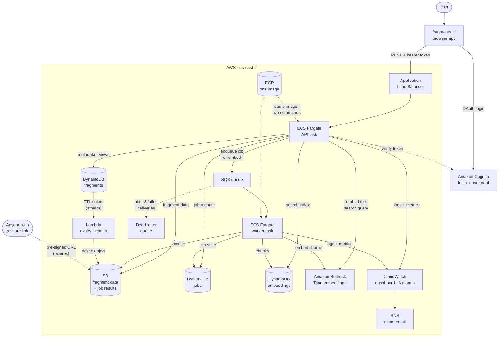
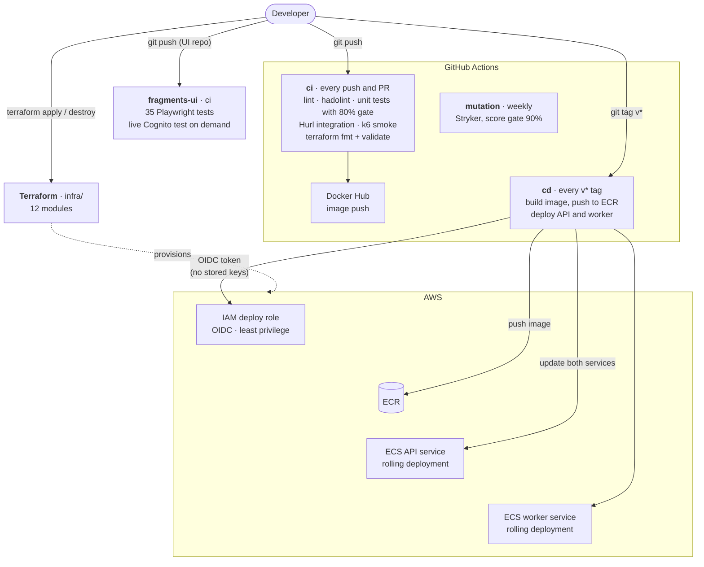
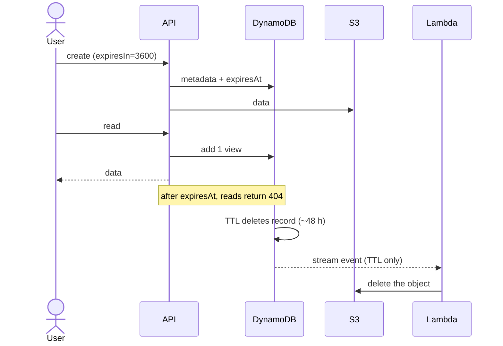
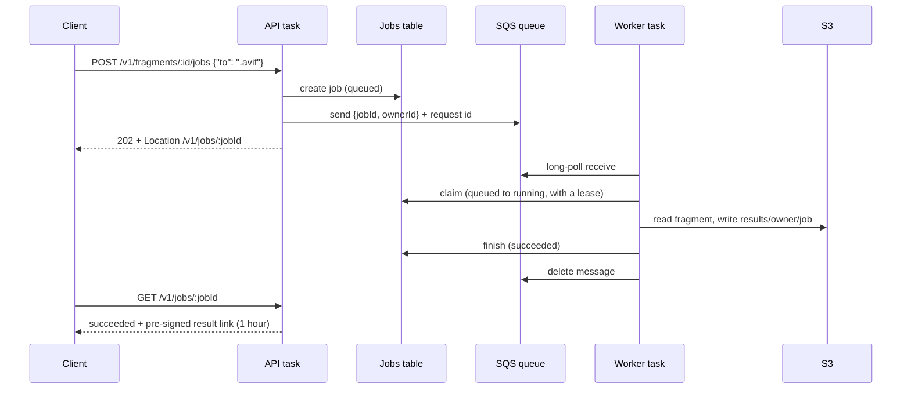
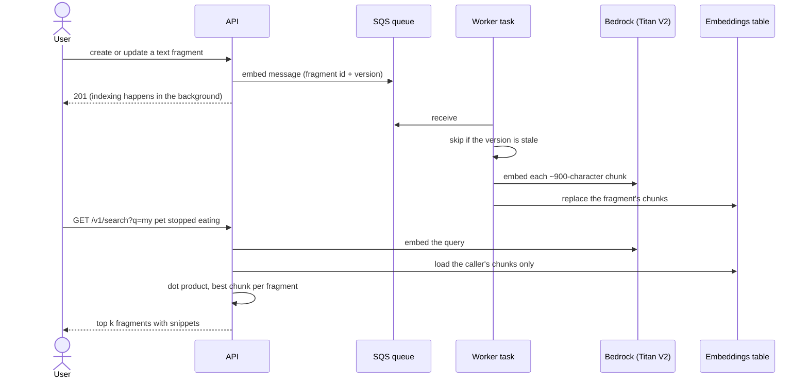

# Fragments

[](https://github.com/AjayMaan13/fragments/actions/workflows/ci.yml)

> **A cloud-native API on AWS Fargate for storing, converting, sharing and semantically searching small pieces of data.** Everything is Terraform; heavy conversions run on an SQS-backed worker; search uses Amazon Bedrock embeddings. Load-tested, mutation-tested and observable.

Users store "fragments" (text, markdown, HTML, CSV, JSON, YAML, XML and images), get them back converted to other formats, share them with expiring links, and find them by meaning. The whole environment is defined in Terraform and can be created or destroyed with one command. Every push runs lint, unit, integration and load-smoke tests; every version tag builds an image and rolls it out to AWS through GitHub Actions authenticated with OIDC (no stored AWS keys).

**Demo video:** https://youtu.be/YJZaokns0F0
**Deployment:** on demand, created with `terraform apply` and torn down when not in use (see [Deploying to AWS](#deploying-to-aws)); the API's URL is printed by `terraform output api_url`
**Companion UI:** [fragments-ui](https://github.com/AjayMaan13/fragments-ui) (with 35 Playwright end-to-end tests)

---

## Contents

[What it does](#what-it-does) · [Results at a glance](#results-at-a-glance) · [Architecture](#architecture) · [AWS services](#aws-services-used) · [Tech stack](#tech-stack) · [Engineering highlights](#engineering-highlights) · [API](#api-overview) · [Testing](#testing-strategy) · [Limitations](#design-notes-and-limitations) · [Layout](#repository-layout) · [Deploying](#deploying-to-aws) · [Local development](#local-development) · [Documentation](#documentation)

---

## What it does

- Authenticated users create, read, update and delete fragments through a REST API
- Stores 12 content types: `text/plain`, `text/markdown`, `text/html`, `text/csv`, `application/json`, `application/yaml`, `application/xml`, and 5 image formats (`png`, `jpeg`, `webp`, `avif`, `gif`)
- **Converts on read**: 35 conversion paths, requested with a URL extension, without ever storing a second copy:
  markdown → HTML · JSON ↔ YAML · JSON ↔ XML · CSV → JSON · image ↔ image (via `sharp`) · markdown / plain text → **PDF** and **Word (.docx)**
- **Background conversions**: heavy conversions run as jobs on a separate worker over SQS (`POST /v1/fragments/:id/jobs`), so they can't starve the API ([details](#async-conversions))
- **Semantic search**: find your text fragments by meaning with Bedrock embeddings (`GET /v1/search`, [details](#semantic-search))
- **Expiring fragments** (`?expiresIn=<seconds>`): they vanish from reads and lists immediately; DynamoDB TTL and a Lambda then delete the stored data from S3
- **View counts**, incremented atomically in DynamoDB
- **Temporary public share links**: pre-signed S3 URLs, capped at 1 hour and at the fragment's own expiry
- **Image thumbnails** on the fly (`?width=<pixels>`), with a pixel limit that protects the server
- **Observability**: a CloudWatch dashboard, six alarms, custom metrics, and request IDs that follow a request from the API into the worker's logs
- Two swappable backends, chosen purely by environment variables:
  - **Auth:** HTTP Basic (local dev) or Amazon Cognito (production)
  - **Storage:** in-memory (local dev) or Amazon S3 + DynamoDB (production)

---

## Results at a glance

Every number below has a named source in [`docs/`](docs/); none is an estimate.

| | Result | Source |
|---|---|---|
| **Unit tests** | 608 tests, 97.96% line coverage (80% gate enforced in CI) | `npm run coverage` |
| **Integration tests** | 20 Hurl files against a docker compose stack (SQS, DynamoDB, S3 mocks) | `npm run test:integration` |
| **UI tests** | 35 Playwright tests in CI with no AWS, plus one live test against real Cognito | [fragments-ui](https://github.com/AjayMaan13/fragments-ui) |
| **Mutation score** | 76.4% → **98.6%** on the core modules (95.1% in GitHub's weekly run, which also covers search) | [`docs/mutation/`](docs/mutation/README.md) |
| **Capacity** | One 0.25 vCPU task is CPU-bound at about **100 req/s** of cheap reads | [`docs/perf/baseline.md`](docs/perf/baseline.md) |
| **Heavy work, in the request** | 20% conversions in the mix: cheap-read p95 **63 ms → over 60 s**, 39% of requests failing, task killed | [`docs/perf/baseline.md`](docs/perf/baseline.md) |
| **Heavy work, on the worker** | Same load: cheap-read p95 **67 ms, 0 of 3,712 requests failed** | [`docs/perf/async.md`](docs/perf/async.md) |
| **One AVIF conversion** | 33 s on the API task (0.25 vCPU), 19 s on the worker (0.5 vCPU) | [`docs/perf/async.md`](docs/perf/async.md) |
| **Search quality** | recall@1 **1.00** vs 0.44 for a keyword baseline (small author-written set, read the caveats) | [`docs/search.md`](docs/search.md) |
| **Search on AWS** | Indexed within seconds, about 0.2 s per search including the Bedrock call; other users see nothing | [`docs/search.md`](docs/search.md) |
| **Failure handling** | Worker killed mid-job: attempt 2 exactly one visibility timeout later, one result, empty dead-letter queue (local); worker stopped mid-job on AWS: job finished, no duplicate | [`docs/perf/async.md`](docs/perf/async.md) |
| **Infrastructure** | 12 Terraform modules, 6 CloudWatch alarms, no long-lived credentials anywhere | `infra/` |

---

## Architecture



The API and the worker are the **same Docker image** started with different commands (`node src/index.js` and `node src/worker.js`), each its own ECS service with its own IAM role: the API can only *send* to the queue, the worker can only *receive*.

### Delivery pipeline

Terraform owns the infrastructure and the task definitions' settings; CI/CD only ships new images.



### Life of an expiring fragment



### Life of a background conversion



### Life of a search



---

## AWS services used

| Service | Role |
|---|---|
| **ECS (Fargate)** | Serverless containers: the API service and the queue-worker service, no managed EC2 instances |
| **ECR** | Private Docker image registry (one image, used by both services) |
| **Elastic Load Balancing (ALB)** | Public entry point, routes traffic to healthy API tasks (HTTP; HTTPS is not enabled) |
| **S3** | Fragment data (public access blocked, shared only through expiring pre-signed URLs) and background-job results (a lifecycle rule deletes them after a day) |
| **DynamoDB** | Three on-demand tables: fragment metadata (TTL + stream), job state (conditional updates, TTL) and the search index (one item per text chunk, TTL) |
| **SQS** | The job queue with a dead-letter queue (3 deliveries), long polling, a 120 s visibility timeout |
| **Bedrock** | Titan Text Embeddings V2 (256 dimensions) for semantic search, called with IAM only, permitted for that one model |
| **Lambda** | Deletes an expired fragment's data from S3 when DynamoDB's TTL removes its record |
| **Cognito** | User authentication via OAuth 2.0 / OIDC hosted login; JWT bearer tokens verified server-side |
| **IAM** | Separate least-privilege roles for the API, the worker and task execution, plus a GitHub OIDC deploy role so CI needs no stored AWS keys |
| **CloudWatch** | Structured logs (Pino JSON), a dashboard, six alarms and custom metrics written as Embedded Metric Format log lines (no extra infrastructure) |
| **SNS** | Email notification for alarms |
| **VPC** | Default VPC; security groups let only the load balancer reach the API containers |

---

## Tech stack

- **Runtime:** Node.js, Express
- **Auth:** Passport (HTTP Basic + Bearer/Cognito JWT strategies), `aws-jwt-verify`
- **Data and messaging:** AWS SDK v3 for S3, DynamoDB, SQS and Bedrock Runtime, plus the S3 request presigner
- **Conversions:** `sharp` (image transcoding and resizing via libvips), `js-yaml`, `csvtojson`, `markdown-it`, `fast-xml-parser`, `pdfkit` (PDF), `docx` (Word)
- **Search:** Titan Text Embeddings V2 on Bedrock, a small chunker, normalised vectors compared by dot product
- **Infrastructure:** Terraform (12 modules)
- **Logging and metrics:** Pino (structured JSON), CloudWatch Embedded Metric Format, request IDs end to end
- **Security:** Helmet (security headers), CORS, an image pixel limit and a concurrency cap
- **Testing:** Jest, Hurl, k6, Stryker (mutation testing), Playwright (UI), Docker Compose with DynamoDB Local and MiniStack (S3 and SQS mocks)
- **CI/CD:** GitHub Actions: lint, hadolint, unit tests with a coverage gate, Hurl integration, k6 smoke, Terraform format/validate, a weekly mutation run, and on every version tag an ECR publish and rolling deployment of both services authenticated with GitHub OIDC
- **Containerization:** Multi-stage Dockerfile, production dependencies only in the final image

---

## Engineering highlights

Measured, with the commands and raw numbers in [`docs/`](docs/):

- **Found and fixed real failures by load testing** ([`docs/perf/baseline.md`](docs/perf/baseline.md)). With k6 against the deployed 0.25 vCPU task: it is CPU-bound at about 100 req/s; one 758 KiB PNG that decodes to 256 megapixels killed the container with a single request; and a mix with 20% conversions took cheap-read p95 from 63 ms to over 60 s with 39% of requests failing. Fixed with an image pixel limit (422) and a cap on concurrent conversions.
- **Async pipeline, measured before and after** ([`docs/perf/async.md`](docs/perf/async.md)). Moving conversions to an SQS worker (dead-letter queue, conditional DynamoDB writes, leases) took the same load to cheap-read p95 **67 ms with 0 of 3,712 requests failing**. The honest remainder: one 0.5 vCPU worker finishes one AVIF per about 19 s, and small jobs queue behind heavy ones.
- **At-least-once delivery, one result.** Every job state change is a conditional write; a finished job can't be claimed again and a worker that lost its lease can't overwrite the one that took over.
- **Mutation testing, not just coverage** ([`docs/mutation/`](docs/mutation/README.md)). Line coverage was 96% while only 76.4% of mutants were caught; 234 targeted tests raised it to **98.6%** and found a real bug (a failed resize returned its error labelled as an image).
- **Observability** ([`docs/observability.md`](docs/observability.md)). A CloudWatch dashboard, six alarms and custom metrics, all Terraform. Load tests showed the first 5xx alarm missed load-balancer-generated errors; it was fixed and then seen firing.
- **Semantic search on Bedrock** ([`docs/search.md`](docs/search.md)). Verified on the deployed stack; recall@1 1.00 against 0.44 for keyword matching on a small author-written set.
- **End-to-end UI tests** in [fragments-ui](https://github.com/AjayMaan13/fragments-ui): 35 Playwright tests in CI with no AWS or backend, plus a manual live test against real Cognito.

And the foundations:

- **Everything as code**: every AWS resource is in Terraform, so the whole environment can be created, or destroyed to stop billing, with one command; CI/CD only ships images
- **No long-lived credentials in CI**: GitHub Actions assumes a least-privilege IAM role through OIDC, limited to this repository's version tags
- **Least-privilege IAM**: the API can touch only its own bucket and tables and may only *send* to the queue; the worker may only receive and write results; Bedrock is limited to one model
- **Zero-downtime rolling deployments** of both services
- **Environment-driven configuration**: the identical codebase runs against an in-memory store locally and real AWS in production, switched only by which environment variables are present
- **Atomic counters and self-cleaning data**: view counts use DynamoDB's atomic `ADD`; expiry is enforced on read and cleaned up asynchronously through a DynamoDB stream and Lambda

---

## API overview

| Method | Path | Description |
|---|---|---|
| `GET` | `/` | Health check (includes server hostname, useful for verifying load balancing) |
| `POST` | `/v1/fragments` | Create a new fragment (`?expiresIn=<seconds>` makes it expire, up to 30 days) |
| `GET` | `/v1/fragments` | List the authenticated user's fragments (`?expand=1` for full metadata) |
| `GET` | `/v1/fragments/:id` | Get a fragment's raw data |
| `GET` | `/v1/fragments/:id.ext` | Get a fragment converted to another supported format (`.html`, `.txt`, `.yaml`, `.json`, `.xml`, `.pdf`, `.docx`, image extensions) |
| `GET` | `/v1/fragments/:id/info` | Get a fragment's metadata only (includes `viewCount` and `expiresAt`) |
| `GET` | `/v1/fragments/:id/share` | Get a temporary public link to the fragment's data (`?expiresIn=<seconds>`, default 15 min, max 1 hour) |
| `POST` | `/v1/fragments/:id/jobs` | Convert in the background: body `{"to": ".avif", "width": 800}`. Answers `202` with a `Location` to poll ([details](#async-conversions)) |
| `GET` | `/v1/jobs/:jobId` | A job's status (`queued`, `running`, `succeeded`, `failed`), attempts, and a download link when done |
| `GET` | `/v1/search?q=...&k=5` | Semantic search over your text fragments, best match first, with a snippet ([details](#semantic-search)) |
| `PUT` | `/v1/fragments/:id` | Replace a fragment's data (its type is immutable) |
| `DELETE` | `/v1/fragments/:id` | Delete a fragment (and remove it from the search index) |

Image fragments accept `?width=<pixels>` on reads (with or without an extension) to return a smaller copy, e.g. `/v1/fragments/:id.webp?width=200`.

All `/v1/*` routes require authentication (HTTP Basic locally, or a Cognito bearer token in production). Every response carries an `X-Request-Id` (a valid incoming one is honoured).

### Semantic search

`GET /v1/search?q=<text>&k=<1-20>` finds a user's text fragments **by meaning**, not by shared words: "my pet cat stopped eating" finds a note about cat health that never uses those words.

- **Indexing is a background job.** Creating or updating a text, markdown or HTML fragment queues an `embed` message on the same SQS queue the conversion jobs use. The worker splits the text into overlapping chunks of about 900 characters, embeds each with **Amazon Bedrock Titan Text Embeddings V2** (256 dimensions, normalised) and stores them in their own DynamoDB table. A message for an out-of-date version is skipped; deleting a fragment removes its chunks.
- **No stored credentials.** Bedrock is called with the task's IAM role, allowed to invoke only that one model.
- **Search is brute force, on purpose.** The API embeds the query, scores the user's chunks by dot product (the vectors are normalised, so that is cosine similarity), keeps the best chunk per fragment, and returns the top `k`. It only ever reads the caller's own chunks. That is fine up to a few thousand chunks per user. Beyond that you would use a real vector index (OpenSearch Serverless, pgvector), which costs money while idle and so conflicts with the apply-and-destroy workflow.
- **Memory mode** answers `501`. Locally, docker compose uses a deterministic fake embedder so the plumbing runs with no AWS.
- **Measured:** recall@1 of 1.00 against 0.44 for a keyword-overlap baseline on a 30-document, 25-query set that I wrote, and verified on the deployed stack. It is an easy benchmark: read [`docs/search.md`](docs/search.md) before quoting it.

### Async conversions

Converting inside the request is fine for small things, but some conversions are slow: a 1080p JPEG to AVIF took about 33 s of CPU on the 0.25 vCPU API task, and under load that starved every other request (see [`docs/perf/baseline.md`](docs/perf/baseline.md)). So there is also a background path (diagram above).

- **At-least-once, but one result.** SQS can deliver a message twice. Every state change is a conditional write in DynamoDB: a finished job can't be claimed again, and a worker whose lease ran out can't overwrite the worker that took over.
- **Worker dies mid-job:** the message reappears after the queue's visibility timeout (120 s) and another attempt claims the job. Locally, killing the worker mid-conversion gave attempt 2 exactly 120 s later and one success.
- **Failures:** an error retrying can't fix (image over the pixel limit, fragment deleted) fails the job immediately with the reason. Other errors retry with backoff; after 3 attempts the job is `failed`. Messages that still can't be handled land in the dead-letter queue, which has an alarm.
- **Jobs belong to their creator.** Someone else's job id answers `404`, same as a missing one. Job records and results are deleted after a day.
- **Not available in memory mode** (no queue): `POST` answers `501`.
- The synchronous `GET /v1/fragments/:id.ext` routes are unchanged.

---

## Testing strategy

| Layer | What | How to run |
|---|---|---|
| **Unit** | 608 Jest tests, 97.96% line coverage, 80% gate enforced in CI | `npm run coverage` |
| **Mutation** | Stryker changes the code and checks a test fails: 98.6% (core modules), gated at 90% weekly in CI. Logging calls are ignored on purpose, the 13 remaining survivors are explained | `npm run mutation` ([report](docs/mutation/README.md)) |
| **Integration** | 20 Hurl files against docker compose (API, worker, DynamoDB Local, MiniStack S3 + SQS): every route, every conversion, jobs, search, authorization | `npm run test:integration` |
| **Load** | k6 smoke (runs in CI) and a staircase load test with a configurable mix of reads, small conversions and heavy images | `perf/README.md` |
| **Search quality** | 30 documents, 25 labelled queries, recall@k and MRR against a keyword baseline | `node eval/run.js --embedder bedrock` |
| **UI end-to-end** | 35 Playwright tests (fake session, in-browser fake API) in CI; one live test against real Cognito, run on demand | [fragments-ui](https://github.com/AjayMaan13/fragments-ui) |

---

## Design notes and limitations

- **HTTP only.** The load balancer serves plain HTTP; there is no custom domain or TLS certificate. Adding HTTPS would mean a domain plus an ACM certificate, or CloudFront in front.
- **Expiry is enforced on read.** DynamoDB's TTL can take up to about 48 hours to delete a record, so the API treats an expired fragment as missing immediately; the S3 data is then removed by the cleanup Lambda.
- **Share links are capped at 1 hour.** They are signed with the task role's temporary credentials, which rotate. Shared reads go straight to S3, so they are not counted as views.
- **PDFs are Latin-text only.** The built-in PDF fonts cover Latin characters; other scripts and emoji do not render. Bold, italics and links in markdown are flattened to plain text.
- **PDF and Word are output formats.** They can be produced from markdown or plain text, but not uploaded as fragments.
- **Image conversion is bounded, and heavy work belongs in a job.** Images over 16 megapixels are refused with `422`, and at most 2 image conversions run at once (extra requests get `503` + `Retry-After`).
- **The worker is the new bottleneck.** One 0.5 vCPU worker finishes about one AVIF per 19 s, and in the single queue small jobs wait behind heavy ones (head-of-line blocking). Worker auto scaling and a separate queue for heavy conversions are not built.
- **Clients should not poll a job every second.** In testing, 1 Hz polling per waiting job pushed the API to 99% CPU; poll with backoff.
- **Search scale and scope.** Brute-force search is meant for up to a few thousand chunks per user; only text types are indexed, and only the first 40 chunks (about 36,000 characters) of a fragment.
- **Not tested on AWS:** a hard worker crash (a Fargate container can't be SIGKILLed without ECS Exec) and a message actually reaching the dead-letter queue. Both are covered by unit tests and the local run.
- **On-demand deployment.** The load balancer and Fargate tasks cost money while running, so the intended workflow is `terraform apply` to work and `terraform destroy -target=...` when done (see below).

---

## Repository layout

```
src/                 Express API (routes, model, auth, data backends, conversions)
src/worker.js        the queue worker entry point (same image as the API)
src/worker-core.js   what the worker does with one message (jobs and embeds)
src/search/          chunking, embeddings (Bedrock), vector maths, index and search
tests/unit/          Jest unit tests          tests/integration/   Hurl HTTP tests
infra/               Terraform: root config + 12 modules (network, alb, ecs, ecr, iam,
                     storage, auth, events (Lambda), cicd (GitHub OIDC role),
                     observability (dashboard, alarms), queue (SQS + dead-letter
                     queue), worker (second ECS service))
perf/                k6 load tests (smoke + mixed-load staircase), see perf/README.md
eval/                search quality evaluation (corpus, labelled queries, results)
stryker-plugins/     Stryker plugin that skips mutations inside logging calls
.github/workflows/   ci.yml (tests, lint, k6, terraform), cd.yml (deploy on tag), mutation.yml (weekly)
docs/                perf/ (load-test results), mutation/, observability.md, search.md, UPGRADE_PLAN.md
```

---

## Deploying to AWS

All infrastructure is defined in `infra/` (Terraform); CI/CD only ships new images. To stand it up in a fresh AWS account:

1. Install [Terraform](https://developer.hashicorp.com/terraform/install) and run `aws configure` for the target account. For search, turn on **model access** for *Titan Text Embeddings V2* in the Bedrock console (us-east-2); it is a one-time manual step.
2. `cd infra && terraform init && terraform apply`: creates ECR, S3, three DynamoDB tables, the SQS queue and dead-letter queue, a cleanup Lambda, Cognito, the load balancer, the API and worker services (0 tasks for now), the dashboard and alarms, and the GitHub deploy role.
3. In the GitHub repo, add an Actions **variable** `AWS_DEPLOY_ROLE_ARN` set to `terraform output github_deploy_role_arn`.
4. Push a version tag (`git tag v1.0.0 && git push origin v1.0.0`). The `cd` workflow builds the image, pushes it to ECR and deploys it to both services. Apply Terraform *before* tagging: CD copies the latest task definition, which carries the environment Terraform set.
5. `terraform apply -var desired_count=1 -var worker_desired_count=1` starts the API and the worker (jobs and search indexing need the worker; add `-var alarm_email=you@example.com` for alarm emails). Copy `api_url` and the Cognito values from `terraform output` into `fragments-ui/.env`.

To stop billing, `terraform destroy -target=module.ecs -target=module.alb -target=module.worker -target=module.observability` removes the load balancer, both services, the dashboard and the alarms (data, queues and users are kept, and cost essentially nothing at rest); `terraform destroy` removes everything.

For load tests, `-var enable_password_auth=true` lets scripts log in with a username and password; it is off by default and should be turned off again afterwards. See [`perf/README.md`](perf/README.md).

---

## Local Development

### Prerequisites

- [Node.js](https://nodejs.org/en) (LTS version)
- npm (comes with Node.js)
- [Docker](https://www.docker.com/) (for running the full stack with AWS-compatible mocks)

### Setup

```sh
npm install
```

### Running the server

```sh
npm start          # production mode
npm run dev         # auto-restarts on file changes
npm run debug        # with the Node debugger attached
```

By default the server runs on **http://localhost:8080**. Check it's running:

```sh
curl -s localhost:8080 | jq
```

```json
{
  "status": "ok",
  "description": "fragments service running normally",
  "author": "Ajaypartap Singh Maan",
  "githubUrl": "https://github.com/AjayMaan13/fragments",
  "version": "1.0.0",
  "timestamp": "...",
  "hostname": "..."
}
```

### Running the full local stack

```sh
docker compose up --build -d
./scripts/local-aws-setup.sh
```

This starts the API **and the queue worker** alongside `dynamodb-local` and `MiniStack` (S3 and SQS mocks); the setup script creates the bucket, the queue and its dead-letter queue, and the three tables. Background conversions and search work locally with a deterministic fake embedder, so no AWS account is needed.

### Testing

```sh
npm run lint            # ESLint
npm test                # Jest unit tests
npm run coverage         # Jest with coverage (80% gate)
npm run mutation         # Stryker mutation tests (about 17 minutes)
npm run test:integration  # Hurl integration tests (requires the Docker Compose stack running)
node eval/run.js --embedder bedrock   # search quality (needs AWS credentials + Bedrock access)
```

### Environment variables

| Variable | Purpose |
|---|---|
| `PORT` | Server port (default `8080`) |
| `NODE_ENV` | `production` disables HTTP Basic Auth |
| `HTPASSWD_FILE` | Enables HTTP Basic Auth (dev only, mutually exclusive with Cognito vars) |
| `AWS_COGNITO_POOL_ID` / `AWS_COGNITO_CLIENT_ID` | Enables Cognito auth |
| `AWS_REGION` | If set, switches the data layer from in-memory to S3/DynamoDB |
| `AWS_S3_BUCKET_NAME` / `AWS_DYNAMODB_TABLE_NAME` | Target AWS storage resources |
| `API_URL` | Used to build the `Location` header on creation |
| `FRAGMENTS_LOG_LEVEL` | Pino log level (`info` in production, `debug` for troubleshooting) |
| `AWS_SQS_QUEUE_URL` | Enables async jobs and search indexing: the SQS queue the API sends to and the worker reads from. Without it `POST .../jobs` answers `501` |
| `AWS_DYNAMODB_JOBS_TABLE_NAME` | DynamoDB table holding job records |
| `AWS_DYNAMODB_EMBEDDINGS_TABLE_NAME` | Enables search: DynamoDB table holding the search index. Without it `GET /v1/search` answers `501` |
| `EMBEDDER` / `EMBEDDING_DIMENSIONS` | `fake` uses the local word-hashing embedder instead of Bedrock; vector size (default `256`) |
| `AWS_SQS_ENDPOINT_URL` | Alternate SQS endpoint (MiniStack) for local runs |
| `JOB_MAX_ATTEMPTS` / `JOB_LEASE_SECONDS` | Attempts before a job fails (default `3`, matches the queue's redrive count) and how long a worker may hold a job (default `110` s, just under the queue's 120 s visibility timeout) |
| `MAX_IMAGE_PIXELS` | Largest image (width x height) that will be converted or resized (default 16,000,000); larger images are refused with `422` |
| `MAX_CONCURRENT_IMAGE_CONVERSIONS` | Image conversions allowed at once (default `2`); extra requests get `503` with `Retry-After` |

---

## Documentation

| | |
|---|---|
| [`docs/perf/baseline.md`](docs/perf/baseline.md) | Load test of the synchronous API: capacity, the two ways it crashed, and the fixes |
| [`docs/perf/async.md`](docs/perf/async.md) | The async pipeline measured before and after, job latency, failure and redelivery |
| [`docs/mutation/README.md`](docs/mutation/README.md) | Mutation testing: 76.4% → 98.6%, what it found, and the survivors that remain |
| [`docs/observability.md`](docs/observability.md) | Dashboard, alarms, metrics, request IDs, and what the alarms missed |
| [`docs/search.md`](docs/search.md) | Search evaluation, its limits, and the live verification on AWS |
| [`perf/README.md`](perf/README.md) | How to run the k6 tests against AWS |
| [`docs/UPGRADE_PLAN.md`](docs/UPGRADE_PLAN.md) | The upgrade plan these were built from, with its final status |
